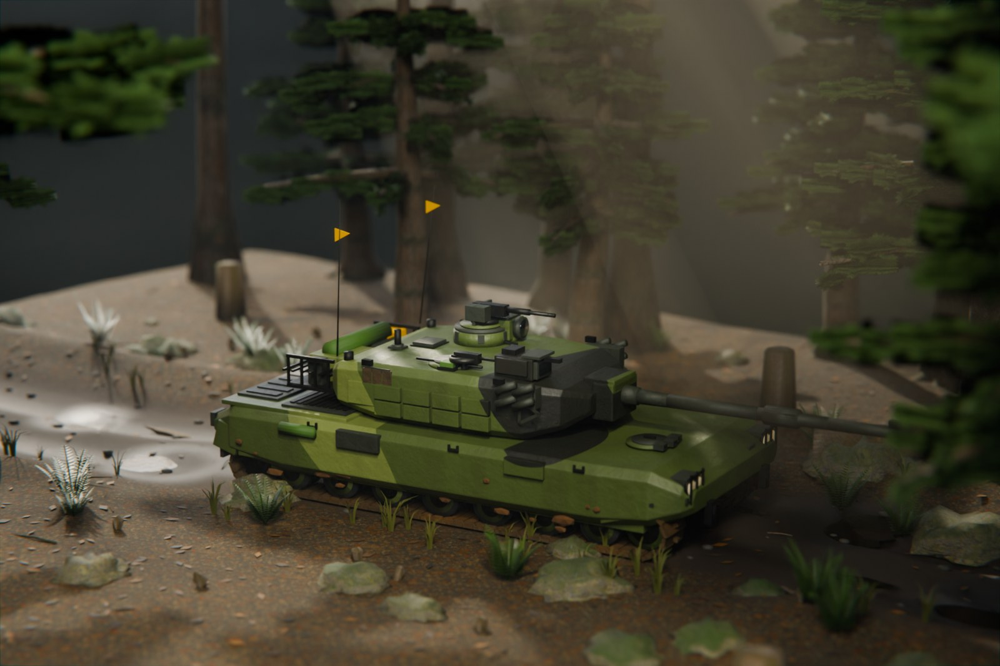

# M1A2T ABRAMS — 1:35 Miniature Forest Diorama

[繁體中文](README.zh-TW.md) · **Live 360° viewer:** <https://caronyang.github.io/m1a2t-diorama/>



A procedural Blender 4.5 build of an **M1A2T Abrams** in a muddy pine-forest
diorama, plus a real-time **three.js 360° viewer** with articulated turret/gun,
animated running gear, three lighting moods, synthesized engine/servo audio and
working headlights.


---

## Live viewer

**<https://caronyang.github.io/m1a2t-diorama/>**

- Drag to orbit, wheel to zoom, right-drag to pan.
- **Turret** yaw: Z axis, ±120°.
- **Gun** elevation: local X, **−10° (down) to +15° (up)**, 0° = level.
- **Drive**: forward/reverse within **±12.8 cm** of the diorama scale; the center
  stops **30 cm from the world edge**. Road wheels rotate by radius and the
  tracks scroll along the stadium curve.
- **Day / Dusk / Night** lighting presets. Dusk and night switch on the two
  headlights, which project real SpotLight beams onto the ground.
- **Sound**: synthesized diesel idle / revs and continuous servo motor sound.
  Browsers require one click before audio can start (click the scene or the
  `Sound` button). Use the same button to mute.
- **Photo** downloads a PNG of the current canvas; **fullscreen** is available.

> The viewer is a static site. The GitHub Pages copy lives at the repository
> root (`index.html`, `main.js`, `vendor/`, `scene.glb`); `web/` is the source
> copy used by the local server.

---

## What is in the scene

- **M1A2T Abrams** modelled from primitives/bmesh at 1:35: hull, turret, 120 mm
  gun with a continuous thermal sleeve and bore evacuator, side skirts, seven
  road-wheel stations per side, drive sprockets, idlers, segmented tracks,
  CITV/GPS, commander and loader machine guns, smoke dischargers, antennas with
  yellow pennants, bustle rack, ERA tiles, unit triangle markings, spare links.
- **Diorama**: 30 × 22 m forest section at 1:1, scaled to 1:35 — muddy road,
  wheel ruts, puddles, pine boughs, ferns, mossy rocks, logs, stumps, leaf and
  needle litter, plus a walnut plinth and a readable brass-framed nameplate.
- **Animation rig**: `CTRL_Turret` (Z limit), `CTRL_Gun` (child of the turret,
  X limit), `CTRL_Hull` (local Y travel), and wheel/idler/sprocket drivers fed
  by the hull's travel.
- **Materials**: procedural camo and weathering plus CC0 Poly Haven textures
  for bark, forest floor, mud and mossy rock. The generated pine-bough alpha
  sprite replaces the earlier solid foliage blobs.

---

## Files

| Path | Purpose |
|---|---|
| `index.html`, `main.js`, `style.css`, `vendor/`, `scene.glb` | GitHub Pages site (repository root) |
| `web/` | Local source copy of the viewer |
| `m1a2t_diorama.blend` | Full Blender scene with relative textures in `scripts/textures/`, rig and Cycles camera |
| `renders/M1A2T_diorama_final.png` | 1800 × 1200 Cycles final render |
| `preview.jpg` | Web/repo preview (1600 × 1067) |
| `scripts/main.py` | Build the whole scene, rig, save `.blend`, render |
| `scripts/tank.py` / `env.py` / `mats.py` / `rig.py` | Tank, forest, materials, rig |
| `scripts/export_web.py` | Bake textures → Draco/WebP GLB |
| `scripts/make_pine_texture.py` | Generate the pine-bough alpha sprite |
| `scripts/textures/` | Poly Haven CC0 textures + generated pine sprite |
| `start_viewer.bat` | Local static server (port 8090) for the `web/` copy |

> The `ref/` photos used for visual reference are kept locally and **not
> redistributed** in this repository.

---

## Run locally

```powershell
# The site can be served from the repository root ...
cd m1a2t-diorama
python -m http.server 8090 --bind 127.0.0.1
# ... or double-click start_viewer.bat (serves web/)
```

Open <http://127.0.0.1:8090/>. A local HTTP server is required; `file://` will
block ES modules, the GLB and DRACO.

### Blender

1. Open `m1a2t_diorama.blend`; textures are in `scripts/textures/` (relative paths).
2. `BeautyCam` is an 80 mm f/6.3 camera with shallow depth of field.
3. Press `F12` for a Cycles/OptiX render (1800 × 1200, 160 samples).

Rig controls live in the `RIG` collection:

| Object | Role | Constraint / driver |
|---|---|---|
| `CTRL_Hull` | hull travel | move along local Y (web: ±0.128 m) |
| `CTRL_Turret` | turret yaw | Limit Rotation, local Z ±120° |
| `CTRL_Gun` | gun elevation (child of turret) | Limit Rotation, local X −10°…+15° |
| `CTRL_Wheel_*` | road wheels | driver from `CTRL_Hull.location[1]`, radius 0.305 m |
| `CTRL_Idler_*`, `CTRL_Sprocket_*` | idler / drive sprocket | same driver, radius 0.305 / 0.30 m |

Move `CTRL_Hull` with **G → Y** and the wheels spin automatically. The Blender
track meshes are static; curve-based rolling is reproduced in the browser with
two `InstancedMesh` sets because glTF does not export Blender drivers/curve
modifiers. The `.blend` retains the editable `Track_L`/`Track_R` and
`CTRL_TrackScroll` objects.

### Rebuild

```bash
# Build the scene, save .blend and render (a few minutes)
blender -b --factory-startup --python scripts/main.py

# Build without rendering
blender -b --factory-startup --python scripts/main.py -- --quick --norender

# Bake textures and export web/scene.glb (Draco + WebP)
blender -b --factory-startup --python scripts/export_web.py

# If the viewer changed, copy the static site to the repository root
cp -r web/* .
```

Use the Blender executable from your own installation (or run these scripts
from Blender's Scripting workspace). No machine-specific paths are required.

`export_web.py` opens the `.blend` in a scratch session, joins the animated
groups, smart-UVs and bakes the tank/terrain/trees/base albedo into 2048 px
images, then exports a Draco-compressed GLB. The original `.blend` is untouched.

---

## Notes and limitations

- The model is an **artistic procedural approximation**, not a CAD-accurate
  M1A2T; proportions and details follow the supplied reference photos.
- Foliage uses alpha-tested cards (5 crossed cards per bough cluster) to keep
  the real-time scene light while reading as pine needles.
- The tank's headlights are three.js SpotLights + additive sprites in the web
  viewer; the Cycles still render uses the scene lighting.
- Audio is generated at runtime with the Web Audio API. No audio files are
  included. Audio starts only after a user gesture because of browser autoplay
  policies.
- `docs` is not used; GitHub Pages is configured from the `main` branch root
  (`.nojekyll` included), matching the reference setup of
  [`caronyang/winter-cabin`](https://github.com/caronyang/winter-cabin).

---

## Credits

- **Poly Haven** — forest floor / bark / mud / mossy rock textures (CC0).
- **three.js r160** — MIT.
- **Blender 4.5** — GPL.
- Model, diorama, renders and web viewer — © caronyang.
