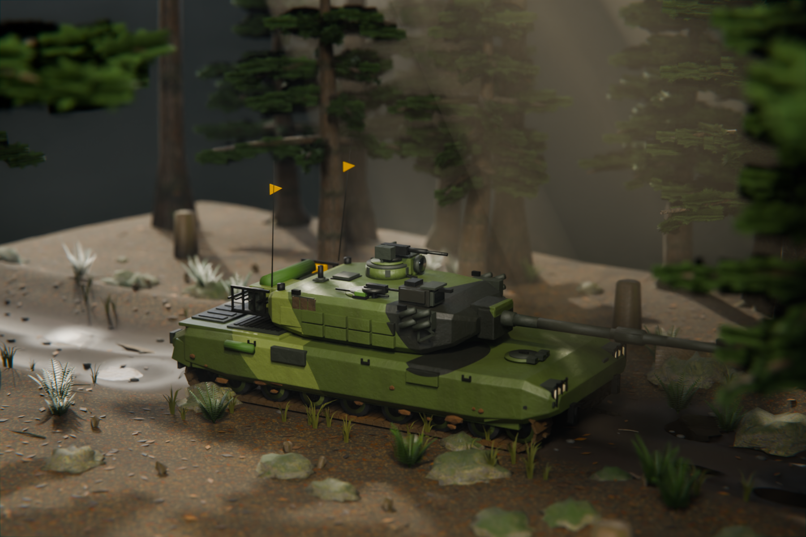

# M1A2T ABRAMS · 微縮森林場景 (1:35)

[English](README.md) · **Live 360°：** <https://caronyang.github.io/m1a2t-diorama/>

以 Blender 4.5 程序化建模的 M1A2T Abrams 微縮場景，外加用 three.js 製作的
360° 互動網頁，包含主砲開炮、炮口閃光與輕煙、後座力／世界震動、合成炮聲，
以及手機版小圖示控制列。參考照片放在本機 `ref/`，因版權未包含在公開 repo。



---

## 1. 檔案總覽

| 路徑 | 說明 |
|---|---|
| `m1a2t_diorama.blend` | 主場景（材質置於 `scripts/textures/`，使用相對路徑，可直接開啟算圖） |
| `renders/M1A2T_diorama_final.png` | 1800×1200 Cycles 最終算圖 |
| `preview.jpg` | README／GitHub 預覽圖 |
| `index.html`、`main.js`、`style.css`、`vendor/`、`scene.glb` | GitHub Pages 靜態網站（repo 根目錄） |
| `web/` | 360° 網頁原始碼（本機伺服器用） |
| `web/scene.glb` | 烘焙材質、Draco + WebP 的網頁模型 |
| `README.md` / `README.zh-TW.md` | 英文（預設）／中文說明 |
| `scripts/` | 全部建模／材質／匯出腳本 |
| `scripts/make_pine_texture.py` | 程序化松枝 alpha 貼圖產生器 |
| `scripts/textures/` | Poly Haven CC0 貼圖 + 松枝貼圖 |
| `start_viewer.bat` | 一鍵啟動本機 `web/` 伺服器並開啟瀏覽器 |

---

## 2. 快速瀏覽網頁

### 線上瀏覽（GitHub Pages）
**<https://caronyang.github.io/m1a2t-diorama/>**

GitHub Pages 設定：`main` 分支、根目錄 `/`，並包含 `.nojekyll`；
repo 根目錄的 `index.html`／`main.js`／`vendor/`／`scene.glb` 是部署副本，
`web/` 是本機開發來源。若更新 `web/`，同步到根目錄後 push 即可。

### 方法 A：雙擊 `start_viewer.bat`
腳本會在本機啟動一個靜態伺服器（預設 port **8090**），並用瀏覽器開啟
`http://127.0.0.1:8090/`。

> 注意：不能用 `file://` 直接開 `index.html`，瀏覽器會阻擋 GLB 與 ES module 載入。

### 方法 B：手動
```powershell
cd web
python -m http.server 8090 --bind 127.0.0.1
```
再開 `http://127.0.0.1:8090/`。

### 網頁操作
- **拖曳**：旋轉／360° 瀏覽
- **滾輪**：縮放
- **右鍵拖曳**：平移
- **砲塔旋轉**：限制 Z 軸，±120°
- **砲管俯仰**：限制 X 軸，**0° = 與地面平行，往上 +15°、往下 −10°**
- **光影場景**：白天 / 黃昏 / 夜晚三組燈光、背景與曝光；夜晚與黃昏會點亮車頭燈
- **車身前進**：車身沿 Y 軸前進／後退，範圍 **±12.8 cm**（邊界 = 世界邊緣 −30 cm）；
  負重輪依半徑旋轉、履帶沿曲線滾動
- **主砲開炮**：點擊面板紅色 **FIRE / MAIN GUN** 鍵或按 **F**。會有炮口閃光、
  上升輕煙、合成炮聲、砲管／車體後座力與整個微縮世界震動；1.15 秒裝填冷卻，
  狀態顯示 `READY / FIRING / RELOAD`
- **手機／窄螢幕（≤900 px）**：大面板自動換成底部小圖示列。`☀` 切換光影，
  `↺` / `⌃` / `⇄` 分別展開砲塔／砲管／車身小托盤，`▣` 展開視角、自動旋轉與重設；
  紅色 **FIRE** 鍵固定可用，預設鏡頭會自動拉遠以完整顯示坦克
- **音效**：預設合成柴油引擎聲；拖動砲塔／砲管時播放伺服／機械聲；開炮播放合成炮聲。
  瀏覽器會要求先有一次點擊（點畫面或「音效」按鈕）才會啟動音訊
- **自動旋轉 / 自動行進**：展示模式
- **坦克特寫 / 側面 / 全景**：三個預設鏡頭（全景可看到木底座與銘牌）
- **拍照**：下載目前畫面 PNG；**⛶**：全螢幕

### 音效（Web Audio 合成，無外部音檔）
- **柴油引擎**：低頻振盪器 + 低通噪音 + 汽缸點火 LFO，預設開啟並維持怠速；
  **只有在車身實際移動時**才會拉高轉速／音量，停止後平滑回到怠速。
- **伺服／機械聲**：拖動砲塔或砲管滑桿時，播放**連續**的馬達／齒輪聲，
  停止操作後淡出（不是斷續的點擊聲）。
- **主砲**：低頻 shelf、sub-bass、衝擊噪音、飽和器與短森林回聲合成；
  開炮瞬間引擎／伺服會短暫降音量，讓炮聲更突出。
- 瀏覽器 autoplay 政策：第一次點擊畫面或「音效」按鈕後才會出聲；右上「音效」可靜音。

---

## 3. Blender 使用方式

開啟 `m1a2t_diorama.blend`：

- 場景比例為 **1:35**、單位為公尺（整個 diorama 約 0.9 m 寬）。
- 相機：`BeautyCam`（80 mm、f/6.3、景深對焦在砲塔）。
- 算圖：**Cycles + OptiX**，1800×1200、160 samples、OIDN denoise。
- 按 `F12` 即可重新算圖（材質貼圖在 `scripts/textures/`，使用相對路徑）。

### 動畫控制器（Outliner → `RIG` collection）

| 物件 | 功能 | 限制 |
|---|---|---|
| `CTRL_Hull` | 車身移動；**沿 local Y 前進** | 建議 ±0.128 m（世界邊緣 −30 cm） |
| `CTRL_Turret` | 砲塔水平旋轉 | Limit Rotation：僅 Z 軸，±120° |
| `CTRL_Gun` | 砲管俯仰（`CTRL_Turret` 的子物件） | Limit Rotation：local X，−10°（下）~ +15°（上） |
| `CTRL_Wheel_*` | 負重輪 | Driver：由 `CTRL_Hull.location[1]` 帶動，`-travel / 0.305` |
| `CTRL_Idler_*` / `CTRL_Sprocket_*` | 惰輪／主動輪 | 同上（半徑對應 0.305 / 0.30 m） |
| `TANK_ROOT` | 坦克根節點 | local Y = 車頭方向（已補償世界旋轉） |
| `SCENE_ROOT` | 整個場景 | 旋轉 +90°，讓坦克在最終世界中面向 +Y |

操作方式：選取 `CTRL_Hull`，用 **G → Y**（沿其父空間 Y）移動，輪子會自動旋轉。
轉動 `CTRL_Turret`（Z）與 `CTRL_Gun`（X）即受上述角度限制。

> `CTRL_Hull` 的 driver 變數是它自己的 local Y 位移；輪子半徑以 1:35 縮放後的公尺為單位。
> 履帶在 Blender 內仍是靜態網格；**滾動效果在網頁端以同一條 stadium curve 的
> InstancedMesh 重建**（因為 glTF 不會匯出 Blender driver / curve rig）。
> .blend 內保留可編輯的 `Track_L` / `Track_R` 與 `CTRL_TrackScroll` 供修改。

### 坦克修正與細節
- 主砲：改成 **單一連續熱護套 + 砲膛排煙器（bore evacuator）** 的平滑外型，
  移除先前會看起來像「束一圈」的接環；內部仍有連續 `gun_core`，砲彈通道沒有斷面。
- 砲塔：煙霧發射器往前移並嵌入斜面、M240 彈箱增加固定座、風向感測器與屋頂握把
  增加底座／支腳；側面置物箱與備用履帶塊改為貼齊並加掛軌。
- **漂浮物件根因已修**：新增的 `smoke_mount` / `smoke_base` / `sideboxrail` 名稱沒有被
  rig 的 turret 前綴規則選到，所以被留在 hull 而沒有跟著炮塔轉；現在改名為
  `smoke_*` / `sidebox_rail_*`，會烘焙進 Turret 並一起旋轉。原本在車體上的
  `travel_lock`（砲管行軍固定器）已移除，避免被誤認為炮塔漂浮件。
- 車頭燈：網頁在黃昏／夜晚會點亮兩側頭燈（合成 spotlight + 發光 sprite），
  並實際照亮前方地面；白天為微弱燈光。
- 底座銘牌：改為 **黃銅外框 + 深色內板 + 大字金色字樣**，尺寸加大，
  在網頁「全景」可直接辨識。
- 樹葉：改為 **程序化松枝 alpha 卡**（`pine_bough.png`，由 `scripts/make_pine_texture.py`
  產生），不再使用綠色圓球團塊；每簇 5 張交叉卡片。
- 迷彩：程序化 blotch + 舊化 dust/grime；1:35 比例。
- 其他：CITV、GPS、車長/裝填手機槍、煙霧發射器、天線＋黃旗、bustle rack、
  ERA tiles、三角識別標、備用履帶塊、底盤與路輪細節。

---

## 4. 重新產生

```bash
# 重建場景並算圖（數分鐘）
blender -b --factory-startup --python scripts/main.py

# 只重建、不渲染
blender -b --factory-startup --python scripts/main.py -- --quick --norender

# 重新烘焙 GLB（材質烘焙 + Draco；數分鐘）
blender -b --factory-startup --python scripts/export_web.py
```

使用你電腦上安裝的 Blender 執行檔（若不在 PATH，可從 Blender 的
Scripting workspace 執行這些腳本）；不需要任何本機路徑。

- `scripts/main.py` 會建立場景、rig、算圖並儲存 `.blend`。
- `scripts/export_web.py` 會開一份暫存場景：join 幾何 → Smart UV → bake →
  Draco GLB，輸出到 `web/scene.glb`，不會覆蓋原始 `.blend`。
- 快速測試可加 `-- --fast`（較低解析度烘焙）。
- 更新 `web/` 後，把內容複製到 repo 根目錄再 push，GitHub Pages 會重新建置：
  ```bash
  cp -r web/* .
  ```

---

## 5. 技術備註

- 場景與模型皆為程序化幾何（bmesh / loft / curve sampling），沒有使用外部 3D 模型；
  松枝貼圖也是由 `scripts/make_pine_texture.py` 以 PIL 產生。
- 材質使用 Poly Haven **CC0** 貼圖（forest floor、muddy tracks、bark、mossy rock），
  混用程序化節點；置於 `scripts/textures/`。
- 網頁使用 three.js r160、OrbitControls、GLTFLoader、DRACOLoader、
  RoomEnvironment；所有 vendor 檔案已放在 `web/vendor/`，可離線使用。
- 光影：白天／黃昏／夜晚三組 Directional/Area/Spot 燈光、世界漸層、霧與曝光；
  夜晚使用冷色月光，車頭燈以 SpotLight + Additive Sprite 呈現並照亮地面。
- 樹葉：alpha 測試（`alphaTest`）的松枝卡片，匯出 WebP 保留透明通道；
  坦克／地形則烘焙成 2048 WebP 貼圖。
- 音效：Web Audio 即時合成，無任何音檔；引擎、伺服聲與主砲由 Oscillator + Filter +
  Noise + WaveShaper 組成。
- 履帶：網頁以兩組 `InstancedMesh`（鋼板 + 橡膠墊）沿曲線參數化滾動，
  並同步負重輪、惰輪、主動輪轉角。
- 座標：Blender 為 Z-up，glTF/three.js 轉為 Y-up；`CTRL_Hull` 在 Blender
  以 local Y 前進，於網頁等同 `hull.position.z`。控制面板仍以模型座標
  Y 軸標示。
- 模型為藝術性還原，並非 CAD 精確圖；主要比例參考 `ref/` 照片（未包含在公開 repo）。
- 部署方式參考 [`caronyang/winter-cabin`](https://github.com/caronyang/winter-cabin)：
  GitHub Pages 使用 `main` 分支根目錄、`.nojekyll`，靜態資源放在 repo 根目錄。

### 授權 / Credits
- Poly Haven textures — CC0
- three.js — MIT
- Blender — GPL
- 模型、場景、算圖與網頁 — © caronyang
